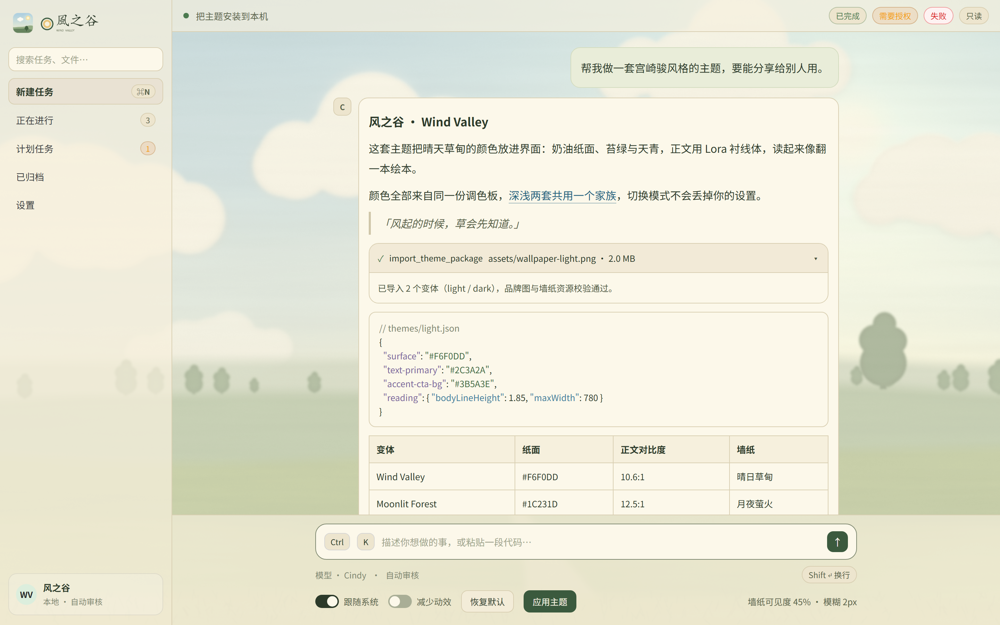
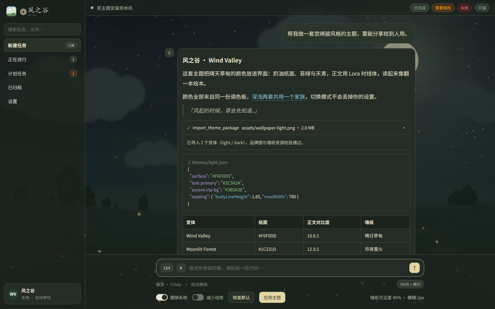

# 風之谷 · Wind Valley — Cindy 主题

一套宫崎骏气质的 Cindy 主题：**晴日草甸**（亮）与 **月夜萤火**（暗），同一 family 两个变体。
奶油纸面、苔绿、天青、赭黄；正文字体 Lora，代码字体 JetBrains Mono；自带手绘墙纸与品牌图标。




## 安装（约 30 秒）

**Windows（PowerShell）**

```powershell
irm https://raw.githubusercontent.com/wztlink1013/cindy-theme-wind-valley/main/install.ps1 | iex
```

或手动三步：

1. 下载 [`wind-valley.cindy`](https://github.com/wztlink1013/cindy-theme-wind-valley/releases/latest/download/wind-valley.cindy)
2. 双击它（`.cindy` 已关联到 Cindy，会弹出导入器）
3. 在 **设置 → 外观 → 主题** 里选 **風之谷 · Wind Valley**

**macOS / Linux**

```bash
curl -fsSL https://raw.githubusercontent.com/wztlink1013/cindy-theme-wind-valley/main/install.sh | bash
```

导入只把主题加进列表，不会自动切换；切换请到 设置 → 外观 → 主题。

## 更新

仓库发布新版本后，用同一条命令再跑一次即可：包里 ID 不变，Cindy 会**原地更新**内容，
不会出现重复条目，已选中的主题会继续生效，无需重选。

## 内容

| 项目 | 亮色 Wind Valley | 暗色 Moonlit Forest |
| --- | --- | --- |
| 纸面 `surface` | `#F6F0DD` | `#1C231D` |
| 正文 | `#2C3A2A`（10.6:1） | `#E9E3D0`（12.5:1） |
| 次要文字 | `#586349`（5.6:1） | `#AFB6A0`（7.7:1） |
| 主按钮 | 森林绿 `#3B5A3E` | 月光金 `#E4D5A4` |
| 边框 | `#D9CFB2` | `#3E4A3F` |
| 墙纸 | 晴日草甸 · 云 · 风车 | 月夜 · 星 · 萤火 |

两个变体都带：品牌图标/字标、静态墙纸（亮 45% / 暗 52% 可见度、2px 模糊）、
Lora 正文、JetBrains Mono 代码与终端、行高 1.85、阅读宽度 780px、
消息间距 14 / 内边距 10 / 圆角 14、动效 0.85。

## 和你的现有设置的关系

Cindy 的规则是「显式设置优先」：

- 如果你自己选过墙纸、字体，主题的同名字段**不会**覆盖它们；到 设置 → 外观 里对该项
  「恢复默认」，它才会跟随主题。
- 「跟随系统」深浅时，亮/暗两个变体会自动切换。

## 仓库结构

```
cindy.json                 主题包清单（v2）
themes/light.json          亮色：548 个颜色 token + appearance
themes/dark.json           暗色：545 个颜色 token + appearance
assets/                    图标、字标、两张墙纸、两款字体
preview/                   预览截图
licenses/                  字体许可（OFL 1.1）
install.ps1 / install.sh   下载最新发布并交给 Cindy 导入
wind-valley.cindy          可直接分发的成品包
```

自己改色：编辑 `themes/*.json` 的 `colors`，然后用 Cindy 的
`validate_theme.py --package-root` 与 `package_theme.py` 重新打包（这两个脚本随 Cindy 的
`cindy-theme-creator` 技能提供）。

> 注意：`*-hsl` 结尾的 token 只能填 HSL 分量（`H S% L%`），其余 token 填完整颜色。
> 把 hex 塞进 `hsl(var(--x))` 会让声明失效，边框会回退成 `currentColor`（也就是一条黑线）。

## 许可

- 插画、图标、字标：**CC BY 4.0**，署名 *wztlink1013*
- Lora、JetBrains Mono：**SIL Open Font License 1.1**，见 `licenses/`

主题包为纯数据（颜色 + 图片 + 字体 + 排版默认值），不含插件代码。
